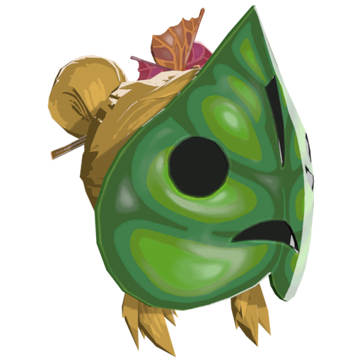

<p align="center"></p>

# korok

> **THIS IS A FULLY VIBE-CODED APPLICATION. USE AT YOUR OWN RISK.**
> If something doesn't work, ask an AI to fix it.

A mod manager, save manager and save editor for **The Legend of Zelda: Breath of the Wild**
on **Cemu**. korok imports mods, merges them together, and writes the result into a
Cemu graphic pack so they work together without conflicts. It also keeps separate save files
for different playthroughs and lets you edit them.

This was made as a stand in for BCML and UKMM because I didn't like how complicated they were to setup and use. If something didn't work, I didn't know why. That's why this was created, it is meant to just "work".

> korok does not include any game files or mods. You need your own legally
> obtained copy of the game, set up in Cemu.

## Features

- Import mods from `.bnp`, `.zip`, `.7z`, UKMM packages, or an unpacked folder
- **One way of handling every mod, the UKMM way.** korok's mod handling is a port of UKMM's own
  code. Every mod is stored the way UKMM stores mods: each file it changes is kept as just the
  *changes* against the game's own version. When you apply a profile, every changed file is
  rebuilt from your game files with all enabled mods' changes merged in, in load order, so mods
  that touch the same file (actor info, game data, texts, packs like `TitleBG.pack`, ...) keep each
  other's changes. Checked file by file against UKMM's own output.
  - **UKMM packages** are used as they are, without needing UKMM.
  - **BCML packages (`.bnp`)** are converted the way UKMM converts them: their merge logs are
    applied to your game files, and the partial packs BCML ships are filled back up with the game
    files they leave out.
  - **Graphic packs / folders** (`content` and/or `aoc`) are compared with your game files.
- **Resource size table** updated for every rebuilt file with UKMM's size calculations, so the game
  reserves enough memory for modded models, textures and data
- **Install options:** mods that come with options (UKMM packages and BNPs) show a window where you
  pick them, with the mod's defaults already selected
- Archives with several mod folders but no option list (hair styles, colours, ...) are imported as
  one main mod plus a switched-off mod per folder, so you can tick the ones you want
- **Profiles:** named sets of mods with their own on/off choices and load order
- **Save Manager:** keep several save slots, each with its own save file and, optionally, its own
  profile. Switching swaps the save Cemu sees and applies the profile for you. korok backs up your
  live save before every switch and can restore from those backups.
  If the game already has save data the first time you open it, that save is added as the
  **Main save** slot.
  Every save slot keeps its own **Cemu graphic packs** (which packs are on and their presets), and
  can have its own **ReShade preset**; they're put in place when you switch to it. A new save slot is
  a brand-new game: an empty save with no graphic packs on.
- **ReShade presets:** keep presets in korok and switch the one Cemu's ReShade uses (or turn effects
  off). While a preset is in use, korok turns on Cemu's *Reshade Compatibility* graphic pack, and
  turns it off again with effects off. ReShade itself is installed once with its own installer (korok
  can't do that part), see
  [Setting up ReShade](#setting-up-reshade).
- **Save Editor:** view and change rupees, inventory items, and individual game flags in a save
  file, with a backup made before every write
- Launch Cemu and BotW straight from korok
- 1-click install links (**WIP**)

korok reads the game's own files from Cemu's `mlc01` folder (base game, update and DLC installed
in Cemu), both when importing a mod and when applying a profile.

## Requirements

- Windows 10 or 11
- [Cemu](https://cemu.info/) 2.x with Breath of the Wild (v208 update and DLC installed)
- Python 3.10 or newer

## Installing Python

1. Download the latest Python for Windows from <https://www.python.org/downloads/>.
2. Run the installer and **tick "Add python.exe to PATH"** on the first page, then click *Install Now*.
3. Open a new Command Prompt or PowerShell window and check it worked:

   ```
   python --version
   ```

## Installing korok

1. Download this repository (green **Code** button, then **Download ZIP**) and extract it,
   or clone it:

   ```
   git clone https://github.com/stenny94/korok.git
   ```

2. Open a terminal in the korok folder and install the requirements:

   ```
   cd korok
   pip install -r requirements.txt
   ```

## Running

> It is highly advised to backup your save data before running this program.
> To do that, right click on BotW in Cemu, open "Save directory", and copy those folders elsewhere.

From the korok folder:

```
python main.py
```

On first start korok opens the **Settings** tab: set your Cemu folder there (Cemu.exe and the game
are filled in automatically when korok finds them). Then:

1. **Import** tab: import your mods. Each one is added to your library and to the active profile.
   (Importing compares the mod with your game files, so set your Cemu folder first.)
2. **Mods** tab: tick the mods you want and set their order (lower in the list wins when two mods
   change the same file).
3. Press **Apply to Cemu** (at the bottom of every tab except Settings). korok builds the **korok Mods**
   graphic pack. If you launch Cemu or BotW with changes not applied yet, korok asks whether to
   apply them first.
4. Start Cemu and make sure the **korok Mods** graphic pack is ticked (Options → Graphic packs).

## The tabs

| Tab | What it's for |
| --- | --- |
| **Mods** | Your profiles (left) and the mods in the active profile (right): turn mods on and off, change the load order, delete mods from your library. |
| **Import** | Import mods (.bnp / .zip / .7z or a folder). |
| **Save Manager** | Your save slots: switch, create, rename, restore backups, and pick which profile and ReShade preset each slot uses. Each slot keeps its own graphic packs. |
| **Save Editor** | Edit rupees, items and game flags in a save. |
| **ReShade** | Import ReShade presets, pick the one in use, or turn effects off. |
| **Settings** | Your Cemu folder, Cemu.exe and the game (a .rpx / .wua file or the game's folder, used by **Launch BotW**), and whether switching profiles applies them to Cemu straight away. |

**Apply to Cemu** (rebuild the korok Mods pack from
the active profile) and **Force full rebuild** (rebuild even if nothing changed) sit below every tab
except Settings; the Apply button shows when there are changes that haven't been applied yet. **Launch Cemu** and
**Launch BotW** sit at the very bottom, on every tab.

## Terms

- **Library:** every mod you have imported (kept in the `korok_library` folder, one UKMM-format
  `mod.zip` per mod). Mods imported with korok versions before the rebuild (in `korok_staging`)
  aren't used any more: import them again. The old folder can be deleted.
- **Profile:** a named set of mods from your library, with its own on/off choices and load order.
  (Older versions of korok called these *playlists*.) Only the active profile is built into the
  pack.
- **Save slot:** a save file kept by the Save Manager, optionally tied to a profile. (Older
  versions called these *instances*.)
- **korok Mods:** the single Cemu graphic pack korok builds. korok never turns your other graphic
  packs on or off.

## Setting up ReShade

Only needed for the ReShade tab. Do this once:

1. On [reshade.me](https://reshade.me), click **Download ReShade** (the plain one, *not* "with full
   add-on support").
2. Run it and pick `Cemu.exe` in your Cemu folder.
3. Rendering API: **Vulkan** (Cemu's default). Pick OpenGL only if you changed Cemu's graphics API to
   OpenGL in Cemu's settings.
4. When it offers effect packages, keep the standard ones ticked: presets need those effects.
5. Start the game in Cemu once. korok can now switch presets (ReShade tab) and give each save slot its
   own (Save Manager > ReShade...).

## Saves

- Close Cemu before switching save slots or editing a save.
- korok backs up the save before every switch and every edit (in the `korok_backups` folder).
  The save editor has had limited testing against real saves, so keep a copy of your own too.

## Compatibility

Mods I have tested with korok. This is a small list, so a mod not being here doesn't mean it won't
work.

### Working

| Mod | Author | Notes |
| --- | --- | --- |
| [The Linkle Mod 3.0](https://gamebanana.com/mods/406768) | lynard killer | Works |
| [Unofficial Linkle 3.0 Armor Icons](https://gamebanana.com/mods/408713) | Benna96 | Works |
| [The Legend of Linkle Dialogue Mod](https://gamebanana.com/mods/439900) | TheFork | Works |
| Zelda's Ballad | YamGaming | Works (BNP version) |
| [Second Wind: The Ancient Trials](https://gamebanana.com/projects/35468) | CEObrainz | Works (UKMM version) |

### Not working

| Mod | Author | Notes |
| --- | --- | --- |
| [Second Wind: The Ancient Trials](https://gamebanana.com/projects/35468) | CEObrainz | BNP version: not working yet. Use the UKMM version |

## Troubleshooting

- **`python` is not recognised**: reinstall Python with *Add to PATH* ticked, or use `py main.py`.
- **`pip install -r requirements.txt` fails on one package**: install the rest by name, e.g.
  `pip install cbor2 zstandard pymsyt`.

## Credits

korok builds on the work of others:

- **[UKMM](https://github.com/NiceneNerd/ukmm)** by Nicene Nerd (GPL-3.0). korok's mod handling
  (packaging, BNP conversion, merging, deploying) is a port of UKMM's code, and `data/ukmm_zsdic`
  and `data/ukmm_filemap_wiiu.json.zst` are UKMM's own data files.
- **[BCML](https://github.com/NiceneNerd/BCML)** by Nicene Nerd (GPL-3.0+), whose BNP format and
  merge logs korok reads.
- **[oead](https://github.com/zeldamods/oead)** by the Zelda Modding community, for reading and
  writing BYML, AAMP, SARC and Yaz0 files.
- **[rstb-rust](https://github.com/GingerAvalanche/rstb-rust)** by GingerAvalanche and Nicene Nerd
  (GPL-3.0), the resource size calculations korok ports, and
  **[rstb](https://github.com/zeldamods/rstb)** for the table format.
- **[msyt](https://github.com/NiceneNerd/msyt)** (via `pymsyt`), for editing game text.
- **[PyQt6](https://www.riverbankcomputing.com/software/pyqt/)** for the interface,
  **[PyYAML](https://pyyaml.org/)**, **[py7zr](https://github.com/miurahr/py7zr)**,
  **[cbor2](https://github.com/agronholm/cbor2)** and
  **[zstandard](https://github.com/indygreg/python-zstandard)**.
- **[Cemu](https://cemu.info/)** and the BotW modding community.

*The Legend of Zelda: Breath of the Wild* is a trademark of Nintendo. korok is an unofficial
fan project and is not affiliated with or endorsed by Nintendo.

## License

korok is released under the **GNU General Public License v3.0**. See [`LICENSE`](LICENSE).
